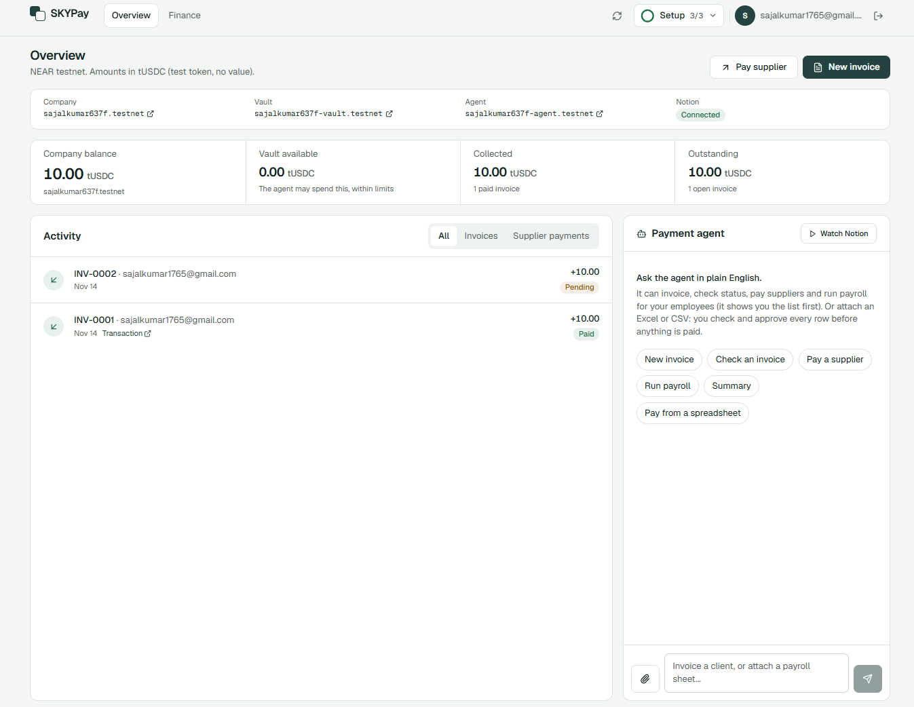
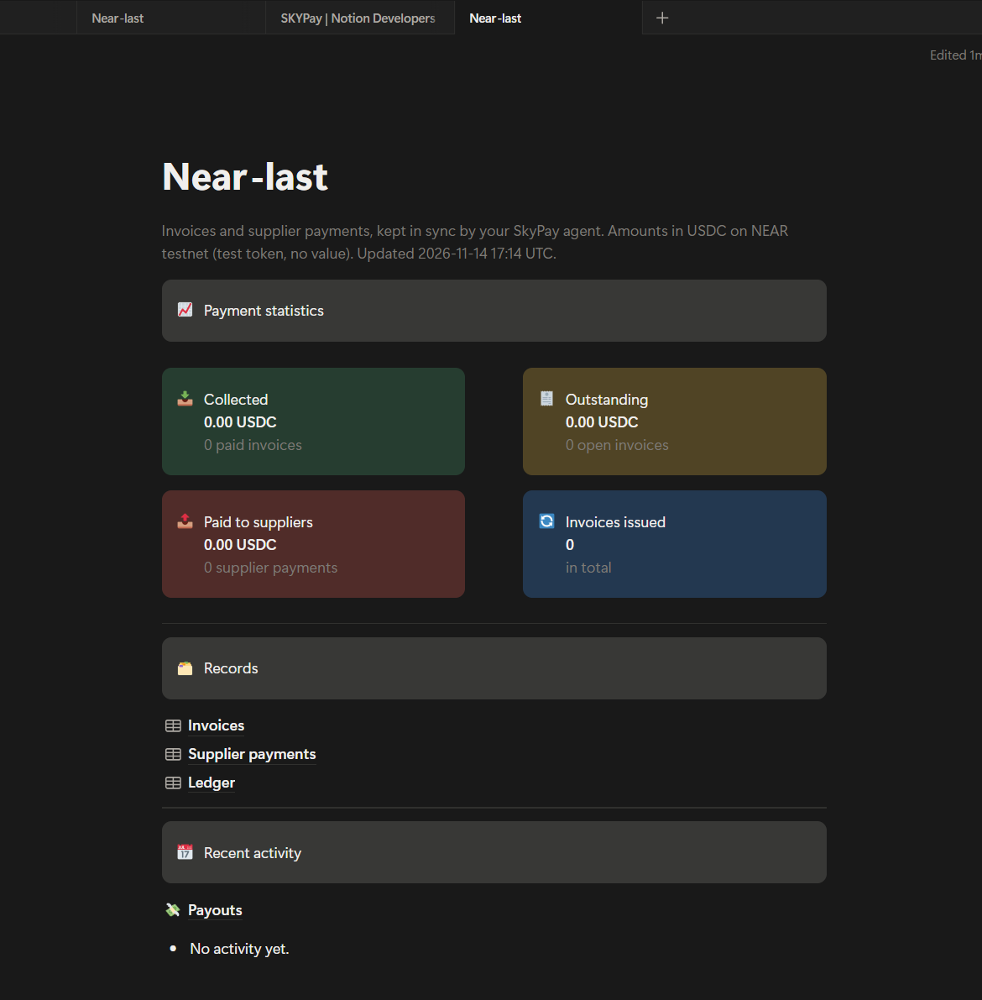
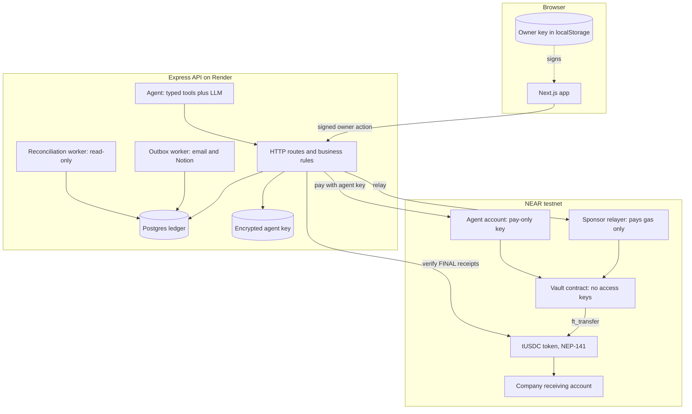
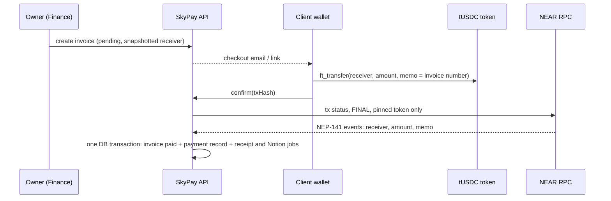
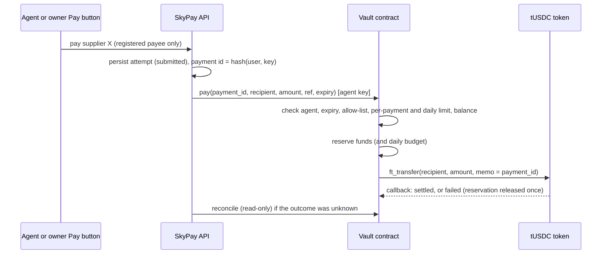

# SkyPay

### A finance workspace for agencies, with spending limits enforced by a NEAR smart contract

SkyPay lets a small agency run its money in one place: bill clients, take a supplier's invoice, pay approved suppliers and staff, and keep the books in step. An AI agent can do the routine work through typed tools, but it cannot move money outside rules that a Rust contract on NEAR enforces. The agent's key can only call `pay` on the company's vault, and the vault refuses anything that is not allow-listed, over the per-payment or daily limit, expired, or replayed.

**Status: NEAR testnet only.** Payments use `tUSDC`, an open-mint test token with **no monetary value**. Cross-chain checkout (NEAR Intents) is **quote-only**: it previews prices and never takes a deposit. Nothing here moves real money.

**Hackathon:** NEAR Real-World Money track, November 2026. **License:** [MIT](LICENSE).

| | |
|---|---|
| Live app | <https://near-skypay.vercel.app> |
| API health | <https://skypay-near-api.onrender.com/health> (returns `database: connected` when Postgres answers) |
| **Agents: start here** | [AGENTS.md](AGENTS.md) (5-minute verification, one-command smoke test) |
| Judge walkthrough | [docs/DEMO.md](docs/DEMO.md) |
| Security model | [SECURITY.md](SECURITY.md) |
| What is and is not claimed | [CLAIMS.md](CLAIMS.md) |

## Screenshots

| Overview: company, vault and agent accounts, a paid invoice with its NEAR transaction, and the payment agent | Notion workspace kept in sync by the agent (stats, Invoices, Supplier payments, Ledger, Payouts) |
|---|---|
|  |  |

Captured while testing on NEAR testnet. Amounts are `tUSDC`, a test token with no value.

---

## 1. What it does

| Job | How |
|---|---|
| **Set up a company on NEAR** | The owner's browser generates a key pair. SkyPay creates the company account, a vault contract, and a restricted agent account. The owner's private key never leaves the browser, and the owner buys no NEAR (the sponsor pays). |
| **Bill a client** | Create an invoice with line items and a due date, or ask the agent. The client pays `tUSDC` to the company's receiving account with the invoice number as the transfer memo. SkyPay marks the invoice paid only after it checks the finalized NEAR transaction. |
| **Fund the operating budget** | The owner moves money from the receiving account into the vault with an owner-signed `ft_transfer_call`. Collected money is never spendable by the agent until the owner allocates it. |
| **Set agent limits** | Per-payment limit, per-day limit, expiry, and a supplier allow-list, all stored on the vault. The owner signs these changes. |
| **Pay suppliers and staff** | Single payments, batch payouts (up to 25 items), and payroll from a spreadsheet. Every payment is recorded before it is sent, and a refusal from the vault is shown as-is. |
| **Supplier bill inbox** | The owner shares a private link. A contractor submits a bill without logging in. SkyPay matches the sender to a registered supplier, flags unknown senders, changed payout accounts and possible duplicates, and the owner pays each bill once. The payout address always comes from the owner's registry, never from the bill. |
| **Keep the books** | Invoice and payment CSV exports (integer token amounts, UTC, transaction links, formula-injection protection), plus optional email receipts and a Notion projection. |

---

## 2. Architecture

### 2.1 Components



| Layer | Code | Responsibility |
|---|---|---|
| Frontend | `agenPay/agenpay-frontend` (Next.js 15, App Router) | Onboarding wizard, Finance workspace, dashboard with agent chat, public invoice checkout, contractor bill pages. Signs owner actions in the browser. |
| API | `agenPay/agenpay-backend/server.js`, `lib/nearRouter.js` | JWT auth, tenant-scoped routes, rate limits, health check. |
| Business rules | `lib/skypay.js`, `lib/bills.js` | Invoice settlement, payee registry, batch and single payouts, supplier bill matching and payment, reconciliation of unknown outcomes. |
| NEAR adapter | `lib/near/NearService.js`, `lib/near/relayGuard.js` | RPC reads, resumable provisioning, receipt verification, agent-signed `pay`, sponsored delegate checks. |
| Agent | `lib/AgentPayAgent.js` | Natural-language requests mapped to typed tools (`create_invoice`, `pay_supplier`, `run_payroll`, `summarize_finances`, and others). The LLM holds no keys and cannot call anything outside those tools; the backend holds the agent's pay-only key, encrypted at rest. |
| Durable side effects | `lib/outbox.js` | Email receipts and Notion records are queued in the same database transaction as the money record. |
| Recovery | `lib/reconciliation.js` | Every 30 s: re-reads unresolved vault payments, recomputes stale payout runs, repairs stuck bills. It never sends a payment. |
| Contracts | `contracts/vault` (policy vault), `contracts/test-ft` (open-mint test token) | Rust, `near-sdk` 5. |
| Ledger | `prisma/schema.prisma` | Users, Invoice, PaymentAttempt, Payee, PayoutBatch, SupplierBill, OutboxJob, SponsorLedger. |

### 2.2 Accounts and who can do what

Every company gets three NEAR accounts. Each one has only the authority it needs.

| Account | Holds | Can do | Cannot do |
|---|---|---|---|
| **Company receiving account** | Client payments (`tUSDC`) | Receive transfers; the owner moves funds out | Be spent by the agent directly |
| **Vault** (contract, **no access keys** after setup) | Allocated operating funds | `pay` (agent only, within limits), `withdraw` (owner only, available funds only) | Be upgraded or redeployed (its keys are deleted) |
| **Agent account** | Gas allowance only | Call `vault.pay` through a function-call key | Transfer tokens, change limits, add payees |
| **Owner key** (browser) | Company full-access key | Fund, set limits, approve suppliers, withdraw | Leave the browser unless the owner downloads a backup |

The sponsor relayer pays gas for owner actions. It holds no user authority. `relayGuard` accepts only two kinds of owner delegate: the five owner methods on the company's own vault (`set_agent`, `revoke_agent`, `add_payee`, `remove_payee`, `withdraw`, with no attached deposit and validated arguments), or an `ft_transfer_call` from the company's account into its own vault. Everything else is refused before it is relayed.

Token spending is controlled by the **vault**, not by the agent's gas allowance. A function-call allowance only limits gas, so the contract enforces the amount limits itself.

### 2.3 Money flows

**Collecting an invoice**



A transaction can settle only one invoice (`settledTxHash` is unique). A client's claim alone never marks an invoice paid.

**Paying a supplier from the vault**



If the response is lost, the attempt stays `unknown`. The reconciliation worker reads the vault's final state and never sends again. A repeated request with the same key returns the existing attempt.

**Supplier bill inbox**

1. The owner shares the bill link. A contractor submits name, email, invoice number, amount and optional payout account.
2. The bill is matched to a registered supplier by email, or by the account they typed. Flags: `unknown_supplier`, `payout_changed`, `possible_duplicate`.
3. The owner reviews it and clicks **Pay**. Flagged bills need an explicit acknowledgement; an unknown supplier must be registered first.
4. The payment goes through the same vault path as any supplier payment. The contractor's status page shows `in review`, `paying`, `paid` (with the transaction link), `failed` or `rejected`.

**Onboarding and recovery**

Setup is resumable. Each step persists its progress, including the encrypted keys generated for accounts not yet created, before the chain action. After an interruption, a retry continues the same accounts. Each step then re-reads the chain: a vault that still holds a key is not treated as finished. The owner's key is checked against the company's registered key before a backup is accepted.

### 2.4 Safety properties (and where they are enforced)

| Property | Enforced by | Test |
|---|---|---|
| Payments go only to owner-registered suppliers | Vault allow-list (on chain) and registry lookup (API) | `payouts.test.js`, contract `a09_unlisted_recipient_refused` |
| Over-limit or expired payments are refused | Vault `pay` | contract `a09`, `a10`, `a13`, sandbox scenario |
| The same payment cannot be sent twice | Vault replay check by `payment_id` and request hash; unique `PaymentAttempt.paymentId` | `a11_same_id_same_payload_does_not_double_spend`, `bills.test.js` in-flight race |
| An unknown outcome is never resent | Reconciliation reads the vault; no resend path exists | `recovery.test.js`, `payouts.test.js` |
| One bill, one payment, under concurrent clicks and crash recovery | Conditional updates on the bill; deterministic payment identity | `bills.test.js` |
| A changed payout account on a bill cannot redirect money | Payee always comes from the owner registry; the bill's account is only compared | `bills.test.js` |
| The vault cannot be upgraded after setup | Its full-access keys are deleted; setup verifies this on chain | `provision.test.js` |
| The vault never runs out of storage mid-payment | Reserve check counts the new record before accepting | contract storage boundary tests |
| Tenants cannot read each other's data | Every private query is scoped to the JWT user | `money-and-guards.test.js` |
| Collected funds are not spendable by the agent | Only owner-signed `ft_transfer_call` with `msg: fund` credits the vault | contract `funding_from_wrong_token_or_wrong_sender_is_refunded` |

---

## 3. Run it

There are two ways to check the project. **Option A needs nothing installed beyond Node.js** and covers the tests and builds. **Option B** runs the whole app locally against NEAR testnet.

### 3.1 Option A: offline checks (about 2 minutes)

Requires Node.js 22.8+ or 24.

```sh
cd agenPay/agenpay-backend
npm ci
npm test                      # 58 tests; database, RPC and provider doubles

cd ../agenpay-frontend
npm ci
npm run lint
npx tsc --noEmit
node --test --test-isolation=none lib/payroll-core.test.ts   # 6 payroll parser tests
npm run build
```

Expected: all backend tests pass (`ℹ fail 0`), lint and TypeScript exit cleanly, and the production build succeeds. Results from the latest run are in [evidence/backend-tests-20261114.txt](evidence/backend-tests-20261114.txt).

Contracts (Linux or WSL, Rust with the `wasm32-unknown-unknown` target, and `cargo-near`):

```sh
bash contracts/build-and-test.sh
```

This rebuilds both contracts, runs the 24 unit tests and the sandbox scenario, and prints the artifact hashes. Output: [evidence/contract-rebuild-20261114-review.txt](evidence/contract-rebuild-20261114-review.txt).

### 3.2 Option B: full local run on NEAR testnet

You need: Docker (for PostgreSQL), Node.js 22.8+ or 24, and a testnet account funded by the sponsor. `npm run near:bootstrap` creates the sponsor account and writes `.env.near`.

```sh
# 1. database
docker run -d --name skypay-pg -p 5434:5432 -e POSTGRES_PASSWORD=skypay -e POSTGRES_DB=skypay postgres:16

# 2. backend
cd agenPay/agenpay-backend
cp .env.example .env          # set JWT_SECRET; add an LLM key for the chat agent
npm ci
npx prisma db push
npm run near:bootstrap        # testnet sponsor; writes .env.near
node server.js                # API on http://localhost:3001

# 3. frontend (new terminal)
cd agenPay/agenpay-frontend
cp .env.local.example .env.local
npm ci
npm run dev                   # app on http://localhost:3000
```

Then open <http://localhost:3000>, register, and go to **Finance**. Create the company NEAR account, download the owner-key backup, get test tUSDC, and fund the vault. The full step-by-step, with expected results, is in [docs/DEMO.md](docs/DEMO.md). Environment variables are listed in [docs/SETUP.md](docs/SETUP.md).

Without SMTP credentials, email is logged in fixture mode and no message is sent. Without a Notion integration, the Notion projection is skipped. Neither affects settlement, because the money record is written first.

### 3.3 Hosted demo

The same code runs at <https://near-skypay.vercel.app> (frontend, Vercel) and <https://skypay-near-api.onrender.com> (API, Render, Postgres on Neon). Health: `GET /health` returns 200 with `database: connected` when Postgres answers, and 503 `degraded` when it does not.

---

## 4. For judges: how the criteria are addressed

| Criterion | What to look at |
|---|---|
| **Technical implementation** | Contract-enforced policy (Section 2.4); conditional, idempotent payment paths with unit and sandbox tests; resumable provisioning checked on chain; receipt verification against finalized NEAR data; recovery that never resends. |
| **Design** | One workspace with plain sections (`Invoices`, `Vault`, `Employees`, `Suppliers`, `Supplier bills`, `Supplier payouts`, `Company`), a readiness panel that says what is missing, and clear labels that tUSDC has no value. |
| **Impact** | An agency's whole outgoing-and-incoming loop (bill, collect, allocate, pay, record) with an AI agent that cannot exceed its owner's limits. |
| **Originality** | The vault is a NEAR-native policy contract with no upgrade path; the agent holds only a pay-only key; supplier bills can be submitted by outsiders but can never choose where money goes. |
| **Sustainability** | Testnet only today. A production path would need: a durable sponsor budget, a key-replacement workflow for the agent's gas allowance, refunds, and a security audit (Section 5). |

**Evidence trail:** test outputs and live testnet transcripts are in [`evidence/`](evidence/README.md). Claims and their limits are in [CLAIMS.md](CLAIMS.md).

**AI and tools used:** the agent in the app uses an LLM (Gemini, OpenAI, OpenRouter or MiniMax, configured by the operator). Development used Claude Code and Codex.

**Libraries:** near-sdk-rs, near-contract-standards, near-workspaces, near-api-js, Wallet Selector, Next.js, Express, Prisma, LangChain/LangGraph.

---

## 5. Limitations (read before judging)

- **Testnet only.** The backend refuses mainnet. tUSDC has no monetary value. Changing a token or RPC variable does not make this a production system.
- **Intents is quote-only.** Cross-chain prices come from the 1Click quote API. There is no deposit address, no deposit tracking, and no refund lifecycle.
- **Owner review of bills is an application control.** The vault enforces the allow-list, limits, expiry and no-double-pay. It does not record a separate per-bill approval, so the agent key could pay an allow-listed supplier within limits without a bill.
- **The owner key lives in browser localStorage**, with backup and verified import as the recovery path. Losing every backup and browser means losing control of the company's accounts. A compromised server can spend up to the limits the owner has already set.
- **Agent gas allowance is finite.** It is shown in the readiness panel. Sending NEAR to the agent account does not refill it, and a key-replacement workflow is not built yet.
- **Not built:** owner-authorized refunds, automatic refunds, partial-payment accumulation, reminders, passkeys or social login, PDF bill extraction.
- **Failed vault callbacks can leave funds reserved** until an operator investigates. There is no automatic override.
- **External delivery is not exactly-once** for email and Notion. A timeout after the provider accepts a message can lead to a second message. The money record is never affected.
- **Payroll lines not dispatched before a crash are not resumed automatically.** The run is shown as partial, never done.
- **Sponsor funding is finite.** Each new company costs about 2.4 testnet NEAR from the sponsor.
- **Not audited.** This is not a production security audit.

---

## 6. Repository map

```
README.md                  this file
SECURITY.md                trust boundaries, secrets, privacy, recovery
CLAIMS.md                  supported claims and their evidence limits
LICENSE                    MIT
render.yaml                API deployment blueprint (Render)
contracts/
  vault/                   policy vault (Rust): pay, fund, set_agent, payees, withdraw
  test-ft/                 open-mint test token (tUSDC)
  build-and-test.sh        rebuild, unit and sandbox tests, hashes
agenPay/
  agenpay-backend/         Express API, Prisma schema, NEAR adapter, agent, outbox, workers, tests
  agenpay-frontend/        Next.js app: onboarding, Finance, Dashboard, checkout, bill pages
docs/
  SETUP.md                 installation and configuration reference
  API.md                   HTTP routes
  DEMO.md                  step-by-step judge walkthrough
  OPERATIONS.md            recovery and troubleshooting
  VALIDATION.md            what was run, when, and the actual results
evidence/                  test outputs and live testnet transcripts
```
