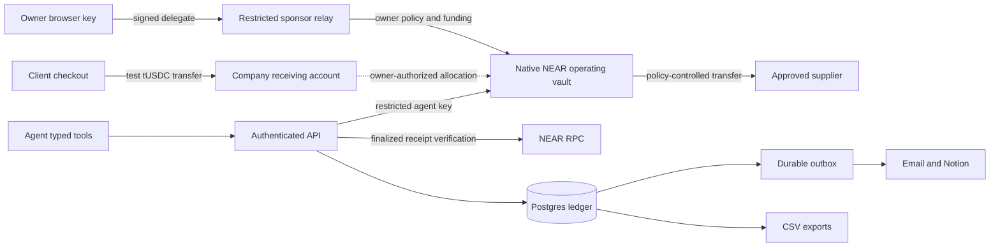

# SkyPay

### A finance workspace for agencies, with spending rules enforced on NEAR

SkyPay brings client invoices, supplier payments, payroll and financial records into one workspace. An owner can ask an agent to request payment, share an emailed checkout link, verify settlement, and keep receipts, Notion views and CSV exports aligned with the ledger. The agent can pay registered suppliers from a separately funded operating vault, within rules enforced by a native NEAR contract.

**Current release: NEAR testnet, using an open-mint test token called tUSDC. It has no monetary value.** NEAR Intents is integrated for **dry price quotes only**. Executable cross-chain collection and real USDC settlement are not implemented. A mainnet quote is not a mainnet payment.

**Hackathon:** Real-World Money, November 2026 | **License:** [MIT](LICENSE)

[Try the app](https://near-skypay.vercel.app) | [Set up locally](docs/SETUP.md) | [Judge walkthrough](docs/DEMO.md) | [Validation evidence](docs/VALIDATION.md)

## The product journey

A small agency needs to collect a client invoice and pay a contractor without giving an AI model control of its treasury.

1. **Set up the company.** SkyPay provisions a company receiving account, an operating vault and a restricted agent account on NEAR testnet. The owner's key is generated in the browser.
2. **Request payment.** Create an invoice with line items and a due date, or ask the agent: `Request 10 USD from client@example.com for a design sprint.` The ledger stores integer token amounts and schedules checkout email and Notion jobs.
3. **Collect and verify.** The client opens the invoice link and pays test tUSDC on NEAR. SkyPay checks finalized token receipts, the receiving account, amount and invoice memo before marking it paid.
4. **Update the books.** Settlement and receipt/Notion jobs commit together. CSV exports come from the database; editing a Notion page does not authorize spending or change settlement.
5. **Allocate operating funds.** The owner explicitly funds the vault. Customer collections do not automatically become agent spending money.
6. **Pay within policy.** The owner approves supplier accounts and sets agent limits. The native contract rejects unauthorized recipients, excessive spend, expired authority and changed-payload replays.
7. **Receive supplier bills.** The owner shares a private inbox link. A contractor submits a bill (no login); SkyPay matches it to a registered supplier by email, flags unknown senders, changed payout details and possible duplicates, and the owner pays it through the vault. The payout account always comes from the owner's supplier registry, never from the bill. The contractor gets a private status page with the NEAR transaction link.

Email and Notion need credentials for actual delivery. Without them, the outbox uses labeled fixture behavior. The complete native testnet walkthrough is in [docs/DEMO.md](docs/DEMO.md).

## What is available today

| Capability | Implementation | Evidence and limit |
|---|---|---|
| Invoices and email checkout | Authenticated invoice service, typed agent tool, line items, due date and stable link | Local tests pass; supplied integration transcript reports SMTP acceptance, not inbox delivery |
| Native collection | Wallet Selector payer checkout and a labeled demo payer; invoice-specific token-event verification | Local verification tests and recorded testnet transactions; test token only |
| Supplier payments | Separate native operating vault, owner-approved payees and restricted agent key | 24 Rust unit tests + 1 sandbox test rerun on November 14 against a fresh rebuild ([evidence](evidence/contract-rebuild-20261114-review.txt)); recorded testnet runs |
| Supplier bill inbox | Public submission link, registry matching, duplicate/changed-payout/unknown-sender flags, one vault payment per bill, contractor status page | 11 local tests (incl. an in-flight request racing crash repair: one dispatch); live testnet run on a freshly provisioned company ([evidence](evidence/bills-smoke-testnet.txt)). Owner review is an app-level control, not an on-chain per-bill approval |
| Onboarding and key recovery | Readiness checklist from live chain reads (owner key, backup, balances, agent policy, agent gas allowance, vault storage reserve, sponsor); explicit backup step; backup import verified against the registered owner key; resumable provisioning | Provisioning resume test crashes after every chain step and checks no account is created twice; wrong-key import refused in a browser check. Not social login, passkeys or custodial recovery |
| Sponsorship | Browser-signed owner delegate actions; sponsor-funded setup and registration | Guard tests pass; recorded testnet evidence. Requires sponsor funding; external payer fees are separate |
| Employees and payroll | Staff records, salary defaults, preview, spreadsheet import and batch execution | Six parser tests pass. Payroll names reserve one run; batch recovery remains incomplete |
| Notion and receipts | Durable jobs project invoices, supplier payments and dashboard data | Supplied transcript reports API acceptance; ambiguous external delivery can require manual reconciliation |
| Accounting exports | Invoice and payment CSV, integer amounts, UTC, transaction links and formula protection | Local tests pass; fixed merchant-fee field is not measured fee accounting |
| NEAR Intents | Catalog-derived source assets and exact-output USDC price previews | Dry quotes only; no executable address, deposit lifecycle or destination settlement |
| x402 | Existing self-hosted testnet payment mapping shares invoice verification | Local tests and recorded testnet evidence; this is SkyPay's mapping, not a claim of an official NEAR x402 standard |

The agent payroll preview/confirmation is a tool and prompt convention. It is **not** a separate signed server approval. The contract's spending policy is the enforceable financial boundary.

## Why NEAR is a core dependency

The operating vault is a Rust contract on native NEAR L1, not Solidity on Aurora. It holds funds explicitly allocated by the owner and checks the caller, recipient allowlist, per-payment limit, daily budget, expiry and payment identity. It reserves funds before its asynchronous token transfer and releases a failed reservation once through a private callback.

A function-call key's allowance is a gas allowance, not a token budget. The vault enforces token spending limits independently of backend checks. Removing NEAR would require replacing custody, policy enforcement, callback accounting and settlement verification.



Provisioning deletes the vault's access keys, leaving no upgrade key. The owner can withdraw available funds through the contract; reserved funds cannot be withdrawn. Verify actual deployed access keys before relying on immutability. See [architecture](docs/ARCHITECTURE.md) and [security](SECURITY.md) for authority, custody and failure boundaries.

## Start with offline verification

Use the repository root containing `agenPay`, `contracts` and `render.yaml`. In some downloaded workspaces this is inside another folder of the same name.

Backend, no database or external service required:

```sh
cd agenPay/agenpay-backend
npm ci
node --test --test-isolation=none test/*.test.js
```

In another terminal, from the repository root:

```sh
cd agenPay/agenpay-frontend
npm ci
npm run lint
node node_modules/typescript/bin/tsc --noEmit
node --test --test-isolation=none lib/payroll-core.test.ts
```

**Latest observed results (November 14, 2026):** 58 backend tests, frontend TypeScript and lint passed. Backend tests use provider/RPC/database doubles; they are not live-payment proof. Runtime was Node v26.3.1; the documented Node 22.8+/24 setup was not separately tested.

Contracts (Linux/WSL, Rust 1.99, cargo-near 0.23): `bash contracts/build-and-test.sh` rebuilds both contracts, runs 24 vault unit tests and the sandbox scenario, and prints artifact hashes. All passed on November 14. The first rebuild (`ee38669f…`) was provisioned live and the company's on-chain code hash matched it. A review follow-up then fixed the storage-reserve check (it must count the new record) and produced `ba41312d…`, now in `near-artifacts/`; that build is verified by unit and sandbox tests but has not been provisioned live yet. Deployed vaults are immutable and keep the code they were created with. See [full validation](docs/VALIDATION.md) and [contract evidence](evidence/contract-rebuild-20261114-review.txt).

## Run the application

Follow [the setup guide](docs/SETUP.md) for complete Bash and PowerShell steps, environment variables and expected results. You need:

- Node.js 22.8+ or 24, npm, and PostgreSQL; Docker is an optional way to run the database.
- A funded **testnet** sponsor and the test token; `npm run near:bootstrap` prepares these and writes `.env.near`.
- Optional model credentials for chat, SMTP credentials for email, and Notion OAuth credentials for workspace sync.

The local API defaults to port **3001**, and the frontend to **3000**. Start the API from `agenPay/agenpay-backend` with `node server.js`; start the frontend from `agenPay/agenpay-frontend` with `npm run dev`, or build and use `npm start` for a production run. Backend configuration is loaded from `.env.near` and `.env`; frontend public configuration is in `.env.local`.

| Published demo endpoint | Purpose |
|---|---|
| [near-skypay.vercel.app](https://near-skypay.vercel.app) | Frontend |
| [API health](https://skypay-near-api.onrender.com/health) | Queries the database: 200 when Postgres answers, 503 `degraded` when it does not. Not a chain-readiness proof |

These are previously published endpoints; current uptime was not independently verified in the latest review. Free hosting can sleep, delaying API responses and pausing workers. Do not repeatedly submit a payment because a request is slow.

## Recovery and known limitations

- **No real-money or cross-chain execution.** The native backend refuses mainnet. Changing an RPC/token variable does not complete a mainnet migration. Intents previews cannot pay testnet invoices.
- **Unknown is not failed.** Recovery queries existing vault payments and never blindly resends. A failed callback can leave funds reserved. Reconcile before any intentional replacement payment.
- **Payroll names are one-shot identifiers.** A company/run-name pair is reserved before dispatch, including failed or uncertain runs. A different name intentionally creates new payments. The recovery worker now recomputes a run's status from its persisted lines (a run whose lines do not add up to its total is never shown as done), but items never dispatched before a crash are not resumed automatically.
- **Supplier bill approval is off-chain.** Review and the Pay click are enforced by SkyPay's API. The vault enforces allow-list, limits, expiry and no-double-pay; it does not record per-bill owner approval, so the agent key could still pay an allow-listed supplier within limits. Binding approval on chain would need a new vault version.
- **Finite agent gas allowance.** The agent's pay-only key has a fixed NEAR gas allowance (0.15 NEAR at setup). Readiness shows what is left; sending NEAR to the agent account does not refill it, and a key-replacement workflow is not implemented yet.
- **Vault storage reserve.** Each payment record stays in contract storage for replay protection. New vaults cap `payment_id` and `invoice_ref` at 64 bytes and refuse a payment with a clear message when the reserve is low; anyone can top it up with a plain NEAR transfer. Readiness shows an estimate of records left.
- **External delivery is not exactly-once.** Crashed running jobs are quarantined; SMTP/Notion acceptance followed by a timeout may need operator review. Provider acceptance is not proof an email arrived or was read.
- **Keys and privacy need care.** The owner key is stored in browser localStorage with backup/import. The backend holds an encrypted restricted agent key. Public chains expose transfer information, and anyone holding a public invoice URL can read its invoice details.
- **Sponsor controls are limited.** Rate limits and replay caches are process-local. Durable cost budgets, nonce coordination and measured operational fees need more work.
- **Accounting is bounded.** Owner-authorized invoice refunds are not implemented (collections sit in the owner-controlled receiving account, and a vault withdrawal is not a customer refund). Refund automation, accumulated partial-payment collection and reminder automation are missing. The CSV merchant-fee value is fixed at zero, not an audited gas-cost ledger.

For operations and troubleshooting, use [docs/OPERATIONS.md](docs/OPERATIONS.md). See [the implementation plan](docs/IMPLEMENTATION_PLAN.md) for remaining release work; this is not a production-readiness claim.

## Documentation and repository map

| Resource | What to read it for |
|---|---|
| [Documentation index](docs/README.md) | Choose the right guide |
| [Setup](docs/SETUP.md) / [Demo](docs/DEMO.md) | Install, run and demonstrate |
| [API reference](docs/API.md) / [Operations](docs/OPERATIONS.md) | Integrate and diagnose failures |
| [Architecture](docs/ARCHITECTURE.md) / [Security](SECURITY.md) | Custody, policies, payment states and trust |
| [Validation](docs/VALIDATION.md) / [Claims](CLAIMS.md) | Actual outcomes and evidence limits |
| [Audit](docs/AUDIT.md) / [Competitors](docs/COMPETITORS.md) | Findings and focused comparison |
| [Plan](docs/IMPLEMENTATION_PLAN.md) / [Migration](MIGRATION.md) | Priorities and old-to-new decisions |

Source: `contracts/vault` is the policy contract; `contracts/test-ft` is the test token. Backend code is in `agenPay/agenpay-backend` (`server.js`, `lib/skypay.js`, `lib/near`, `lib/outbox.js`, `lib/reconciliation.js`, Prisma schema and scripts). Frontend code is in `agenPay/agenpay-frontend`; Finance is the owner workspace, `/invoice/[id]` is public checkout, and `/bills/submit/[token]` and `/bills/status/[token]` are the contractor bill pages (`lib/bills.js` on the backend). `evidence/` contains transcripts; `docs/legacy/` is historical, not current setup guidance.

## Hackathon scope and reuse

SkyPay, formerly AgenPay, reuses an earlier Sei/EVM product with agent, email and Notion functionality. The tag [`baseline-pre-near`](../../tree/baseline-pre-near) marks the migration boundary; inspect [the NEAR diff](../../compare/baseline-pre-near...main). The tag was created during the event and does not independently prove pre-event authorship. Eligible work and dates should be reviewed against the [event rules](https://nearhackathon.com/HACKATHON.md).

The NEAR work includes the vault/test-token contracts, restricted keys and sponsored relay, invoice/settlement ledger, outbox and reconciliation, exports, NEAR checkout, agent tools and Intents dry quotes. Employee/payroll features build on that workspace. Historical Sei wallet/transfer integrations are retained in Git history and legacy documentation.

Libraries include near-sdk-rs, near-contract-standards, near-workspaces, near-api-js, Wallet Selector, Next.js, Express, Prisma and LangChain/LangGraph. Development used Claude Code and Codex. No competitor code was reused in this review. No win, official score or production audit result is claimed.
