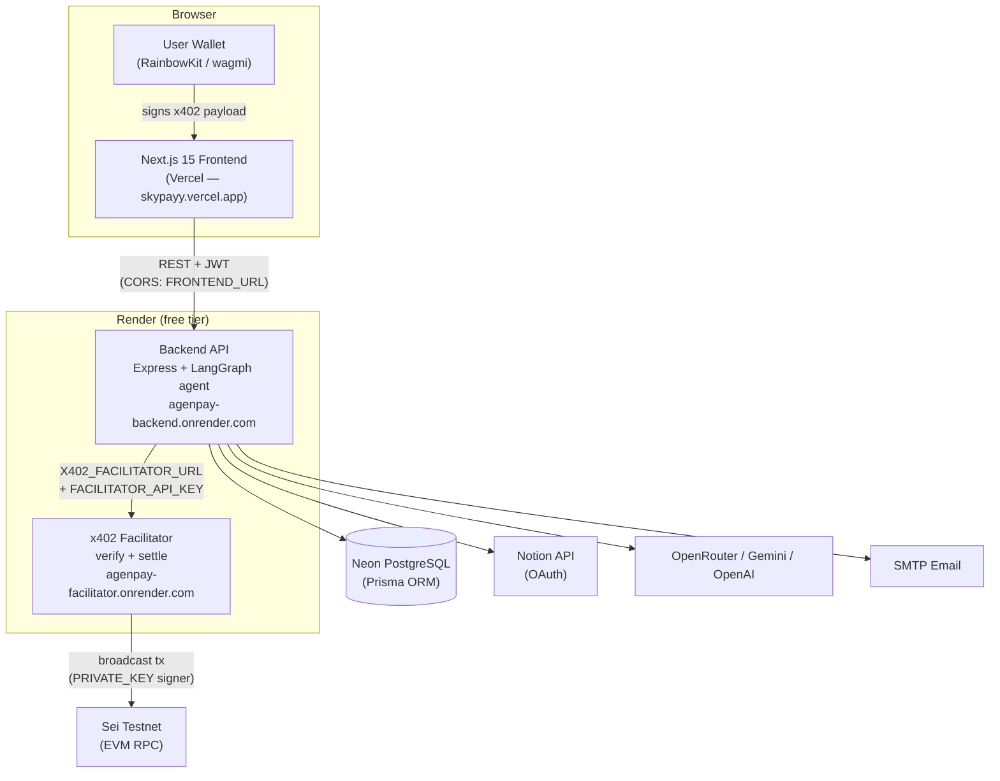
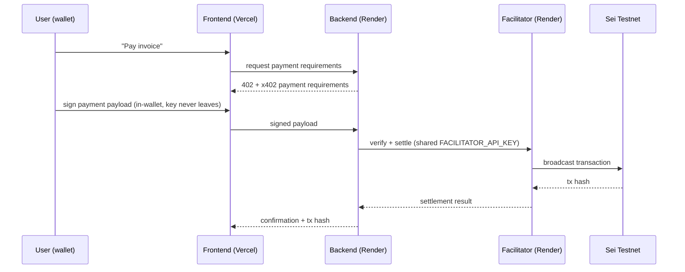
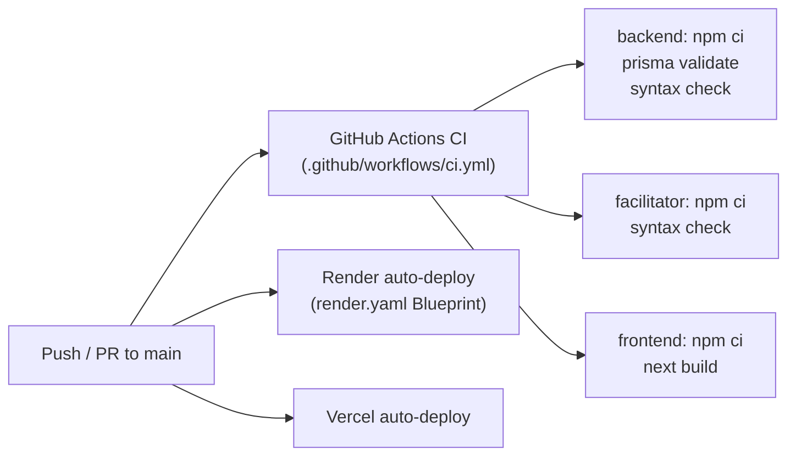

# AgenPay — Agentic Payment Infrastructure for Web3 Teams

<div align="center">

**AI-Powered Crypto Payment System with Autonomous Agent-Driven Processing**

Agentic Stripe for Web3 • Powered by Sei Network


**Live:** [Frontend](https://skypayy.vercel.app) • [Backend API](https://agenpay-backend.onrender.com/health)

</div>

---

## Table of Contents

- [Overview](#overview)
- [Architecture](#architecture)
- [Project Structure](#project-structure)
- [Production Deployment](#production-deployment)
- [CI/CD](#cicd)
- [Local Development](#local-development)
- [API Reference](#api-reference)
- [Security](#security)
- [Troubleshooting](#troubleshooting)
- [License](#license)

---

## Overview

**AgenPay** deploys an AI agent that handles the full crypto payment lifecycle — scheduling, sending, receiving, refunding, and reconciling — autonomously, with Notion as the team-facing interface.

| Feature | Description |
|---------|-------------|
| 🤖 **AI Agent** | LangGraph-powered agent (OpenRouter / Gemini / OpenAI) with natural-language payment commands |
| 💳 **x402 Payments** | HTTP-402 payment protocol on Sei — user signs client-side, facilitator broadcasts on-chain |
| 🔐 **Wallets** | Privy server wallets + browser wallet connect (RainbowKit/wagmi, sign-in with Ethereum nonce flow) |
| 🗃️ **Notion Sync** | OAuth-connected workspace sync for invoices and payment tracking |
| 🛡️ **Admin Portal** | JWT-authenticated admin dashboard with seeded admin account |
| ⚡ **Automation** | node-cron scheduled payments, monitoring, and reconciliation |

---

## Architecture

Three deployed services plus a managed database. The frontend never holds private keys for settlement — users sign payment payloads in their own wallet; the facilitator (holding a funded Sei key) verifies and broadcasts.



**Payment flow (x402):**



---

## Project Structure

```
seiagenpay-main/
├── .github/workflows/
│   └── ci.yml                      # CI: install + build gates for all 3 services
├── render.yaml                     # Render Blueprint (backend + facilitator)
├── DEPLOY_RENDER.md                # Step-by-step deploy runbook
├── SECURITY_CHECKLIST.md           # Security guidelines
├── PRODUCTION_READINESS.md         # Production audit notes
│
└── agenPay/
    ├── agenpay-backend/            # Express API + AI agent (Node 18+, ESM)
    │   ├── server.js               # App entry: routes, auth, CORS, rate limits
    │   ├── agent.js                # Agent instantiation
    │   ├── lib/
    │   │   ├── AgentPayAgent.js    # LangGraph agent (StateGraph, tools, LLM)
    │   │   ├── X402PayService.js   # x402 payment protocol handler
    │   │   ├── WalletService.js    # Privy wallets + Sei balances/transfers
    │   │   ├── NotionService.js    # Notion OAuth + workspace sync
    │   │   ├── SchedulingService.js# node-cron jobs (monitoring, recurring)
    │   │   ├── OKXDexService.js    # DEX token swaps
    │   │   └── adminRouter.js      # /api/admin portal routes
    │   ├── prisma/
    │   │   ├── schema.prisma       # User, Payment, ChatMessage, Admin models
    │   │   ├── seed.js             # Demo data
    │   │   └── seedAdmin.js        # Admin account (create-only, safe re-run)
    │   └── env.example
    │
    ├── agenpay-facilitator/        # x402 settlement service (single file)
    │   ├── index.js                # verify + settle endpoints, Sei broadcaster
    │   └── env.example
    │
    ├── agenpay-frontend/           # Next.js 15 + React 19 (App Router)
    │   ├── app/
    │   │   ├── landing/            # Marketing page
    │   │   ├── auth/               # Login/register + Notion OAuth callback
    │   │   ├── dashboard/          # Main app: chat, payments, wallet
    │   │   ├── admin/              # Admin portal UI
    │   │   ├── docs/               # In-app docs
    │   │   └── api/chat/route.ts   # AI chat edge route
    │   ├── components/             # ui/ (Radix), wallet/, landing/
    │   ├── lib/                    # auth.ts (API client), utils
    │   └── middleware.ts           # Route protection
    │
    ├── start-project.ps1 / .bat    # Local dev startup (Windows)
    └── tunnel-gateway.js           # Local tunnel helper
```

---

## Production Deployment

| Service | Host | URL | Deploys from |
|---------|------|-----|--------------|
| Frontend | Vercel | https://skypayy.vercel.app | `main` (auto) |
| Backend API | Render (free) | https://agenpay-backend.onrender.com | `main` via `render.yaml` (auto) |
| Facilitator | Render (free) | https://agenpay-facilitator.onrender.com | `main` via `render.yaml` (auto) |
| Database | Neon | pooled connection string | — |

> **Free-tier caveat:** Render free services sleep after 15 min idle and cold-start in ~30–50 s. This wipes in-memory agent state and pauses cron loops until the next request. Fine for demo; upgrade to Starter for reliability.

### Environment variables

**Backend** (`agenpay-backend` on Render — Blueprint prompts for all `sync: false` vars):

| Variable | Purpose |
|----------|---------|
| `DATABASE_URL` | Neon **pooled** connection string |
| `JWT_SECRET` | Token signing, strong random (`openssl rand -hex 32`) |
| `ADMIN_EMAIL` / `ADMIN_PASSWORD` | Seeded admin portal account |
| `FRONTEND_URL` | Exact Vercel origin, e.g. `https://skypayy.vercel.app` — controls **CORS** and OAuth redirects. No trailing slash. Comma-separate multiple origins. |
| `X402_FACILITATOR_URL` | `https://agenpay-facilitator.onrender.com` |
| `FACILITATOR_API_KEY` | Shared secret — **must match facilitator's value** |
| `PRIVY_APP_ID` / `PRIVY_APP_SECRET` | Privy server wallets |
| `NOTION_CLIENT_ID` / `NOTION_CLIENT_SECRET` / `NOTION_REDIRECT_URI` | Notion OAuth. Redirect URI = `https://agenpay-backend.onrender.com/api/notion/callback` (must also be allowlisted in the Notion integration settings) |
| `AI_PROVIDER` | `openrouter` (default) — falls back per key availability |
| `OPENROUTER_API_KEY` / `GEMINI_API_KEY` / `OPENAI_API_KEY` / `MINIMAX_API_KEY` | LLM provider keys (only the active provider's key required) |
| `EMAIL_SERVICE` / `EMAIL_USER` / `EMAIL_PASS` / `EMAIL_FROM` | SMTP notifications |

**Facilitator** (`agenpay-facilitator` on Render):

| Variable | Purpose |
|----------|---------|
| `PRIVATE_KEY` | Funded Sei testnet wallet key that signs/broadcasts settlements |
| `FACILITATOR_API_KEY` | Must match backend's value |

**Frontend** (Vercel → Project → Settings → Environment Variables):

| Variable | Purpose |
|----------|---------|
| `NEXT_PUBLIC_API_URL` | `https://agenpay-backend.onrender.com` — baked in at **build time**; redeploy after changing |

### First-time deploy runbook

See [DEPLOY_RENDER.md](DEPLOY_RENDER.md) for the full runbook. Short version:

1. **Neon:** create project, copy the pooled connection string.
2. **Render:** New → Blueprint → point at this repo. Render reads `render.yaml`, creates both services, prompts for env vars. Backend build runs `npm install && npx prisma generate && npx prisma db push && npm run admin:seed`.
3. **Vercel:** import repo, set root directory to `agenPay/agenpay-frontend`, set `NEXT_PUBLIC_API_URL`.
4. **Cross-wire:** set backend `FRONTEND_URL` to the Vercel URL, `X402_FACILITATOR_URL` to the facilitator URL, matching `FACILITATOR_API_KEY` on both Render services.
5. **Notion:** add the backend callback URL to the integration's allowed redirect URIs.
6. **Verify:** `GET /health` returns 200; log in from the frontend; check browser console for CORS errors.

---

## CI/CD



- **CI** ([.github/workflows/ci.yml](.github/workflows/ci.yml)) runs on every push/PR to `main`: clean installs (`npm ci`) for all three services — catching lockfile/peer-dependency conflicts before Render does — plus Prisma schema validation and a full Next.js production build.
- **CD** is platform-native: Render and Vercel both watch `main` and auto-deploy on push. No deploy secrets live in GitHub.
- Failed CI does **not** block platform deploys (they trigger in parallel). Treat a red ✗ on a commit as "the Render/Vercel build for that commit will likely fail too" — fix forward.

---

## Local Development

### Prerequisites

- Node.js 18+ (20 recommended)
- PostgreSQL (local, or reuse a Neon branch)
- One LLM key (OpenRouter recommended)

### Backend

```bash
cd agenPay/agenpay-backend
npm install
cp env.example .env        # then fill in values
npm run db:generate
npm run db:push            # creates tables
npm run db:seed            # optional demo data
npm run admin:seed         # admin portal account
npm run dev                # http://localhost:3001
```

### Facilitator

```bash
cd agenPay/agenpay-facilitator
npm install
cp env.example .env        # PRIVATE_KEY (funded Sei testnet wallet) + FACILITATOR_API_KEY
npm run dev
```

### Frontend

```bash
cd agenPay/agenpay-frontend
npm install
echo "NEXT_PUBLIC_API_URL=http://localhost:3001" > .env.local
npm run dev                # http://localhost:3000
```

Or on Windows, start everything at once:

```powershell
powershell -ExecutionPolicy Bypass -File "agenPay/start-project.ps1"
```

---

## API Reference

Base URL: `https://agenpay-backend.onrender.com` (prod) or `http://localhost:3001` (dev).
Authenticated routes need `Authorization: Bearer <JWT>`.

| Method | Endpoint | Auth | Purpose |
|--------|----------|------|---------|
| GET | `/health` | — | Liveness check |
| POST | `/api/auth/register` | — | Create account, returns JWT |
| POST | `/api/auth/login` | — | Login, returns JWT (rate-limited) |
| GET | `/api/dashboard` | ✅ | Dashboard summary |
| GET | `/api/transactions` | ✅ | Payment/transaction history |
| POST | `/api/agent/process` | ✅ | Natural-language command to the AI agent |
| POST | `/api/agent/start` / `stop` | ✅ | Agent lifecycle |
| GET | `/api/agent/status` | ✅ | Agent state |
| GET | `/api/wallet` / `status` / `tokens` / `networks` | ✅ | Wallet info |
| POST | `/api/wallet/create` | ✅ | Create Privy wallet |
| POST | `/api/wallet/send` | ✅ | Send tokens |
| POST | `/api/wallet/faucet` | ✅ | Testnet faucet |
| POST | `/api/wallet/connect/nonce` → `verify` | ✅ | Sign-in-with-wallet flow |
| POST | `/api/wallet/disconnect` | ✅ | Unlink wallet |
| GET | `/api/notion/auth-url` | ✅ | Start Notion OAuth |
| GET | `/api/notion/callback` | — | Notion OAuth redirect target |
| * | `/api/admin/*` | admin JWT | Admin portal (users, payments, stats) |

---

## Security

- **JWT auth** on all API routes; separate admin JWT for `/api/admin`
- **CORS** locked to `FRONTEND_URL` origins (comma-separated allowlist)
- **Rate limiting** — global `/api` limiter + stricter `/api/auth` limiter
- **Helmet** HTTP security headers
- **bcryptjs** password hashing
- **Non-custodial settlement** — users sign x402 payloads in their own wallet; only the facilitator holds a (testnet) hot key
- **Facilitator API key** — backend↔facilitator calls require the shared `FACILITATOR_API_KEY`

See [SECURITY_CHECKLIST.md](SECURITY_CHECKLIST.md). Known operational task: rotate the Neon database password if it was ever shared in plaintext.

---

## Troubleshooting

| Symptom | Fix |
|---------|-----|
| CORS error in browser console (`blocked by CORS policy`) | Backend `FRONTEND_URL` must exactly equal the frontend origin (scheme + host, no trailing slash). Update on Render → redeploys automatically. |
| First request takes 30–50 s | Render free-tier cold start. Retry; consider Starter plan. |
| `npm install` ERESOLVE on deploy | Peer-dep conflict — CI catches this now. Fix versions locally, regenerate `package-lock.json`, push. |
| `Cannot find module '@prisma/client'` | `npm run db:generate` |
| Frontend calls `localhost:3001` in prod | `NEXT_PUBLIC_API_URL` unset at build time on Vercel — set it and redeploy. |
| Notion OAuth fails | Callback URL missing from the Notion integration's allowed redirect URIs. |
| Login 429 | Auth rate limiter — wait out the window. |

---

## License

MIT © 2024–2026 Sajal (AgenPay Team)

---

Built with ❤️ for Web3 Teams by **Sajal** • **Powered by Sei Network** ⚡
